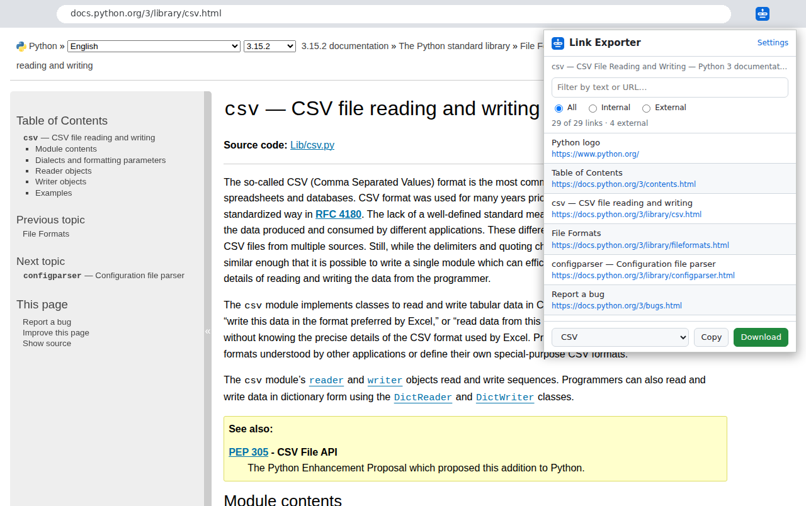
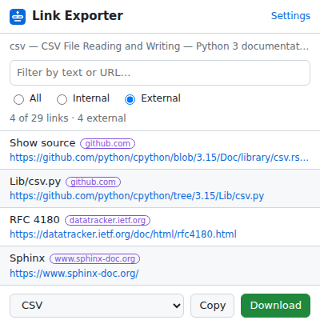
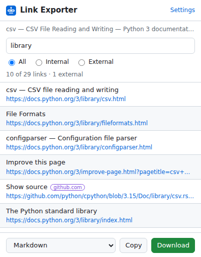
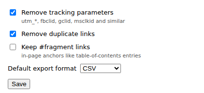

# Link Exporter (Chrome extension)

[](https://github.com/breezy-development/link-exporter-extension/actions/workflows/tests.yml) 

A small Manifest V3 Chrome extension that lists every link on the page you're looking at, lets
you filter them, and exports them as **CSV, Markdown or a plain URL list**. It's handy for SEO
audits, research notes, and checking a page's outbound links.



## Features

- **One click:** open the popup (or press <kbd>Alt</kbd>+<kbd>Shift</kbd>+<kbd>L</kbd>) to see every link with its text.
- **Filter as you type** by link text or URL, and switch between **All / Internal / External**.
  External links get a badge with their domain.
- **Clean output:** relative links are resolved, duplicates are removed, in-page `#anchor`
  links are skipped, and tracking parameters (`utm_*`, `fbclid`, `gclid`, …) are stripped.
  Each of these can be turned off in Settings.
- **Export** to CSV (Excel/Sheets-safe: quoted, with formula-injection protection), a Markdown
  list, or plain URLs. Copy to the clipboard or download a file named like
  `links-example.com-2026-11-07.csv`.
- **Private by design:** the only permissions are `activeTab`, `scripting` and `storage`.
  It reads a page only when you click the button, sends nothing anywhere, and loads no remote code.
- Light and dark mode.

| Filtered to external links | Search | Settings |
|---|---|---|
|  |  |  |

Example export of the external links above:

```csv
text,url,host,external
Show source,https://github.com/python/cpython/blob/3.15/Doc/library/csv.rst?plain=1,github.com,yes
Lib/csv.py,https://github.com/python/cpython/tree/3.15/Lib/csv.py,github.com,yes
RFC 4180,https://datatracker.ietf.org/doc/html/rfc4180.html,datatracker.ietf.org,yes
Sphinx,https://www.sphinx-doc.org/,www.sphinx-doc.org,yes
```

```markdown
- [Show source](https://github.com/python/cpython/blob/3.15/Doc/library/csv.rst?plain=1)
- [Lib/csv.py](https://github.com/python/cpython/tree/3.15/Lib/csv.py)
- [RFC 4180](https://datatracker.ietf.org/doc/html/rfc4180.html)
- [Sphinx](https://www.sphinx-doc.org/)
```

## Install (unpacked)

1. Clone or download this repo.
2. Open `chrome://extensions` and turn on **Developer mode** (top right).
3. Click **Load unpacked** and pick the `extension/` folder.
4. Pin **Link Exporter** from the puzzle-piece menu, open any web page, and click the icon.

Works in Chrome, Edge, Brave and other Chromium browsers (version 102+).

## Development

No build step and no dependencies: plain ES modules.

```bash
npm test          # 12 tests with Node's built-in test runner (Node 20+)
npm run package   # builds dist/link-exporter-<version>.zip for the Chrome Web Store
```

```
extension/
  manifest.json   MV3 manifest (activeTab + scripting + storage only)
  popup.html/css/js
  options.html/js settings stored in chrome.storage.sync
  lib/links.js    pure logic: normalise, dedupe, classify, filter, CSV/Markdown export
  icons/
tests/            node:test suites for lib/links.js and the manifest
scripts/          zip packager (no dependencies)
demo/             chrome.* stub + sample data used to render the README screenshots
```

All link processing lives in `lib/links.js`, which has no browser-extension APIs, so it's
covered by fast unit tests. The popup only collects anchors and renders.

### About the screenshots

The popup and settings screenshots are the real `popup.html` / `options.html` rendered in a
regular tab with `demo/chrome-stub.js` standing in for the `chrome.*` APIs. The stub returns the
links captured from the Python `csv` docs page on 2026-11-07. The hero image places that popup
screenshot over a screenshot of the same page.

## About

Built by Michael (Breezy Development) with AI-assisted development; every line is reviewed and
tested by a human before it ships.

## License

[MIT](LICENSE)
